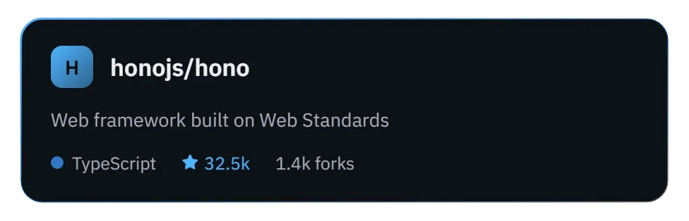

# repora

SVG cards for a GitHub repository. You can embed them in a README.

<a href="https://repora.am1v.wtf"></a>

**Create your card at [repora.am1v.wtf](https://repora.am1v.wtf).** Enter a repo, adjust the style with a live preview, and copy the Markdown, URL or HTML.

## Options

`https://repora.am1v.wtf/<owner>/<repo>?<options>`

| Option | Values | Default |
|---|---|---|
| `style` | `acrylic` `rim` `tinted` `glow` `bar` `solid` | `rim` |
| `layout` | `card` `pill` | `card` |
| `accent` | hex color, `#` optional | `4FB3FF` |
| `bg` `fg` `muted` | hex color, overrides the style's palette | – |
| `width` | 300–800 (card only) | `460` |
| `icon` | path to a png/jpg/gif/webp/svg **inside the repo**, e.g. `assets/logo.png` | monogram |
| `show_icon` `show_owner` `show_description` `show_language` `show_stars` `show_forks` | `true` `false` `1` `0` | `true` |

## Examples

```
/honojs/hono?style=acrylic
/honojs/hono?style=glow&accent=B48CFF&layout=pill
/honojs/hono?style=bar&icon=docs/images/hono-title.png&show_forks=false
/honojs/hono?style=solid&accent=4ADE9B&show_owner=false
```

## Development

```bash
bun install
GITHUB_TOKEN=ghp_... bun dev   # token optional: 60 req/h without, 5000 req/h with
bun test
bun run typecheck
```

`PORT` defaults to 3000.
